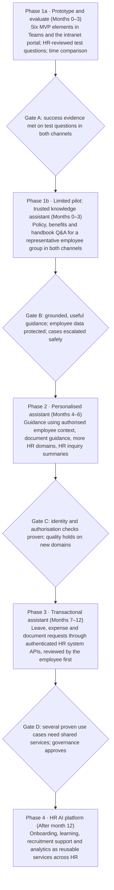

# HR Ally — Product Roadmap and Metrics

## 1. Purpose, alignment and roadmap principles

This document sets out how HR Ally moves from a narrow prototype to a broader HR service, and how success is measured at each step. HR Ally advances only when the evidence from the previous step is in.

| Field | Value |
| --- | --- |
| Product | HR Ally – An AI-Powered Assistant for Employee HR Support |
| Team | TEAM009 |
| Master document | HR Ally Product Proposal |
| Aligned with | HR Ally PRD (aligned to Product Proposal); Product Strategy and Opportunity Framing; Executive Summary |
| Channels | Microsoft Teams integration and intranet web portal, on one shared back end |
| Status | Draft for team review |

### Roadmap principles

1. **Prototype, then evaluate before piloting** (Executive Summary recommendation).
2. **Feature first, platform later:** start with trusted HR policy and benefits Q&A, then expand (Strategy, section 9).
3. **Both channels at every stage:** each release ships to Teams and the intranet portal together, with the same answers and safeguards, and is measured per channel.
4. **Evidence gates:** a phase begins only when the previous phase meets its success evidence.
5. **Human decisions stay human:** final decisions on recruitment, leave approval, compensation, benefits eligibility, performance and policy exceptions remain with authorised staff in every phase.
6. **Accuracy and safety before volume:** guardrail metrics take priority over adoption and inquiry reduction.

## 2. Roadmap at a glance

The roadmap follows the strategy's path from trusted knowledge to personalised guidance, transactions and finally a platform, with the prototype-then-evaluate step first.

Timings are indicative and come from the team's PM Artifact Pack. Every stage runs in both Teams and the intranet portal, and no stage starts until its gate is passed.

## 3. Phase details

| Phase | Timing (indicative) | Goal | Scope in Teams and on the intranet portal | Stays out of scope |
| --- | --- | --- | --- | --- |
| 1a. Prototype and evaluate | Months 0–3 | Prove the six MVP elements work end to end | Concise answer from an approved source; policy or handbook reference; next step; clarification question; safe escalation; feedback. Tested on representative questions with HR-reviewed answers; time compared with the manual process | Live employees; personal data; transactions |
| 1b. Limited pilot: trusted knowledge assistant | Months 0–3 | Prove employees use and trust HR Ally for routine questions | HR policy, benefits and employee handbook Q&A for a representative employee group; sensitive matters routed to HR; content owners maintaining sources | Personalised answers; transactions; final HR decisions |
| 2. Personalised assistant | Months 4–6 | Improve resolution with context-aware guidance | Guidance using authorised employee context (location, eligibility, employment category) after identity and authorisation checks; document guidance; more HR domains; HR inquiries with conversation summaries | Approvals; changes to employee records |
| 3. Transactional assistant | Months 7–12 | Complete routine requests end to end | Leave, expense and document requests through authenticated HR system APIs; the employee reviews details before anything is submitted; HR systems of record keep approvals | AI approving requests or making eligibility decisions |
| 4. HR AI platform | After month 12 | Reuse proven services across HR | Onboarding, learning, recruitment support and analytics as shared services (retrieval, identity, workflow, monitoring, governance) | Performance recommendations (deferred in the strategy's opportunity matrix) |

Across all phases, final decisions on recruitment, leave approval, compensation, benefits eligibility, performance and policy exceptions remain with authorised staff.

## 4. Stage gates and decision criteria

Each gate has three possible outcomes: **proceed**, **iterate** (fix and re-test within the same phase) or **stop**. Every criterion must be met in both Teams and the intranet portal.

| Gate | Between | Must be true to proceed | Evidence reviewed |
| --- | --- | --- | --- |
| A | Prototype → limited pilot | Success evidence SE-1, SE-2, SE-3, SE-5, SE-6, SE-7 and SE-8 met on HR-reviewed test questions; zero sensitive questions answered by AI | Test results by channel; HR reviewer assessment; time comparison |
| B | Phase 1 → Phase 2 | Useful, grounded guidance in live use; employee information protected; cases escalated safely; SE-4 measured; adoption and repeat use healthy | Pilot metrics by channel; feedback; incident log; HR team view |
| C | Phase 2 → Phase 3 | Identity and authorisation checks proven for personal context; accuracy holds on new domains; no unauthorised data exposure | Access-control review; evaluation on new domains |
| D | Phase 3 → Phase 4 | Transactions accurate with employee review before submission; approvals remain in HR systems of record; several proven use cases need common services | Transaction audit; governance review |

At every gate, accuracy and safety outweigh volume: a phase does not proceed on strong adoption if a guardrail target is missed.

## 5. North Star and metric framework

**North Star:** routine HR questions resolved correctly and safely through HR Ally each month, across Teams and the intranet portal.

It combines value (resolved), quality (correctly) and safety (safely), so it cannot be raised by answering more questions badly. A question counts only if it was answered from an approved source, rated or reviewed as correct, and did not need a follow-up HR inquiry.

### Metric levels

| Level | What it tells us | Metrics | Linked success evidence |
| --- | --- | --- | --- |
| Guardrails (must not worsen) | Is it safe and trustworthy? | Answers supported by approved sources; critical policy errors; sensitive questions escalated; unauthorised data exposure | SE-2, SE-7, SE-8 |
| Quality | Is it right and useful? | HR-validated accuracy; helpfulness rating; correct next step reached; clarification exchanges | SE-3, SE-5, SE-6 |
| Efficiency | Is it faster? | Time to answer vs the manual process | SE-1 |
| Business outcome | Does it reduce HR workload? | Repetitive HR inquiries in covered topics; HR time redirected to complex cases | SE-4 |
| Adoption | Do employees come back? | Active users; repeat use; self-service resolution | Supports SE-1 and SE-4 |
| Channel parity | Is it equally good everywhere? | Every metric above, split by Teams and intranet portal | All |

The success evidence codes SE-1 to SE-8 are the eight items in the product proposal, numbered as in the PRD.

## 6. Metrics and targets by stage

The PRD and the strategy document propose slightly different targets. Working targets below take the **stricter** value for safety and accuracy, and the **more conservative** value for adoption and efficiency, in line with the principle of accuracy and safety before volume. All are proposed and confirmed after baselining; each is measured separately for Teams and the intranet portal.

### Guardrail and quality metrics

| Metric | SE | Gate A: prototype (test set) | Gate B: pilot (live use) | Target sources |
| --- | --- | --- | --- | --- |
| Answers supported by approved HR sources | SE-2 | ≥ 98% | ≥ 98% | PRD ≥ 95%; Strategy ≥ 98% |
| HR-validated correct responses | SE-8 | ≥ 95% | ≥ 95% | Strategy ≥ 95% |
| Critical policy errors (materially incorrect, employee-impacting) | SE-8 | < 1%, zero severe | < 1%, zero severe | PRD < 1%; Strategy near 0 |
| Sensitive questions routed to HR, never answered by AI | SE-7 | ≥ 95% routed; zero answered | ≥ 95% routed; zero answered | Strategy ≥ 95%; PRD zero answered |
| Unclear or unanswerable questions given safe fallback | SE-7 | ≥ 90% | ≥ 90% | PRD ≥ 90% |
| Unauthorised data exposure | — | Zero | Zero | PM Artifact Pack |
| Helpfulness rating | SE-3 | ≥ 4.0 / 5 | ≥ 4.0 / 5 | PRD and Strategy |
| Correct form, portal or channel reached | SE-5 | Higher than baseline | Higher than baseline | PRD |
| Clarification exchanges per routine request | SE-6 | Lower than baseline | Lower than baseline | PRD |
| Quality gap between Teams and portal | All | No material gap | No material gap | Channel principle |

### Efficiency, business and adoption metrics

| Metric | SE | Gate A: prototype | Gate B: pilot | Phases 2–3 | Target sources |
| --- | --- | --- | --- | --- | --- |
| Time to obtain HR information vs manual process | SE-1 | Faster than baseline | Faster than baseline; aim for 50% reduction | Maintained | PRD; Strategy ≥ 50% |
| Self-service resolution (no HR follow-up within 24 hours) | Supports SE-4 | Not measured | ≥ 50% (stretch 60%) | 65–70% | PM Artifact Pack; Strategy ≥ 60% |
| Reduction in repetitive HR inquiries, covered topics | SE-4 | Not measured | 20% | 30–40% | PRD; PM Artifact Pack |
| Pilot users returning to HR Ally | — | Not measured | ≥ 50% | Rising | Strategy |
| Active users by channel | — | Not measured | Tracked | Tracked | — |

## 7. Measurement plan and channel reporting

### How each metric is measured

| Metric group | Method | Data source | Cadence | Owner (role) |
| --- | --- | --- | --- | --- |
| Baselines | Time to answer, routing accuracy and clarification exchanges for the current manual process, measured before the prototype test | HR service desk records; timed test questions | Once, before Gate A | Roadmap and metrics lead |
| Accuracy, grounding, critical errors | Representative questions with HR-reviewed expected answers; HR reviewers grade each response | Evaluation test set; reviewer scores | Each prototype build; weekly in pilot | AI and responsible AI lead |
| Sensitive and unclear handling | Test set slice of sensitive, unclear and unanswerable questions | Evaluation test set; escalation log | Each build; weekly in pilot | AI and responsible AI lead |
| Helpfulness | Feedback option on every answer | In-product feedback | Continuous; reviewed weekly | UX and trust lead |
| Time to answer | Same questions answered through HR Ally and the manual process | Timed tests; pilot logs | Gate A; monthly in pilot | Roadmap and metrics lead |
| Inquiry reduction | HR inquiries in covered topics vs baseline | HR service desk records | Monthly in pilot | Business value lead |
| Adoption and repeat use | Active and returning users | Usage logs | Weekly | Roadmap and metrics lead |
| Data protection | Access-control checks; incident review | Audit logs; incident log | Continuous | AI and responsible AI lead |

Owners are shown by role, following the team's role assignments; add team members' names once confirmed.

### Channel reporting

Every dashboard and gate report shows each metric three ways: **Teams**, **intranet portal** and **combined**. A gap between channels that matters is treated as a defect to fix before the next gate, even if the combined figure meets its target.

### Reporting rhythm

- **Weekly (pilot):** accuracy sample, escalations, feedback, adoption by channel.
- **Monthly:** time to answer, inquiry reduction, self-service resolution, content gaps for HR content owners.
- **At each gate:** full metric pack against the targets in section 6, with a proceed, iterate or stop recommendation.

## 8. Roadmap risks, assumptions and open questions

### Risks to the roadmap

| Risk | Effect on roadmap | Response |
| --- | --- | --- |
| Approved HR content is incomplete or outdated | Prototype fails accuracy gates | Content owners review sources before Gate A; narrow the prototype question set if needed |
| Low adoption in one channel | Pilot evidence skewed toward the other channel | Report by channel; fix channel-specific issues before Gate B |
| Integration with HR systems takes longer than planned | Phase 3 slips | Phase 3 starts only after Gate C; phases 1–2 still deliver value without transactions |
| Personal-context features raise privacy risk | Gate C delayed | Prove identity and authorisation checks first; keep Phase 2 scope small |
| Pressure to expand before evidence | Trust damaged by early errors | Gates are binding; accuracy and safety outweigh volume |

### Assumptions

- Indicative timings from the PM Artifact Pack hold for planning.
- Approved HR policies and support resources can be made accessible to HR Ally in both channels.
- Current HR service performance can be baselined before Gate A.

### Open questions

- Does the team adopt the working targets in section 6, where the PRD and strategy document differ?
- Which routine HR topics form the prototype question set?
- Which team members own each measurement area?
- Must the intranet portal work outside the corporate network?
